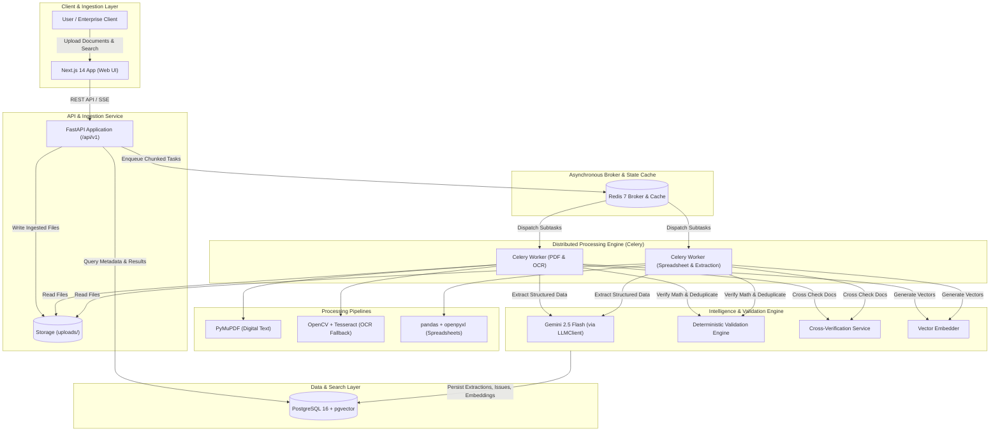

# System Architecture: AI Document Intelligence

## Overview

The system is organized as a decoupled, microservices-ready monorepo comprising:
- **FastAPI Backend (`/backend`)**: High-throughput asynchronous REST API providing file ingestion, document query, result retrieval, manual correction, and search.
- **PostgreSQL 16 + pgvector**: Unified relational metadata store, full-text inverted index (`tsvector`), and high-dimensional vector embeddings for semantic search.
- **Redis 7**: Distributed task queue broker and in-memory cache for ingestion state and live progress counters.
- **Celery Distributed Workers**: Asynchronous, parallel background workers responsible for PDF chunking, OpenCV image preprocessing, Tesseract OCR fallback, spreadsheet parsing, LLM structured extraction, and deterministic validation.
- **Next.js Web Frontend (`/frontend`)**: Modern React interface providing multi-file drag-and-drop ingestion, live page-level progress monitoring, side-by-side inspection with original document rendering, inline validation alerts, editable fields, and hybrid search.

## High-Level Architecture Diagram

## Detailed Processing Flow

1. **Ingestion & Validation**:
   - Client uploads document (PDF, PNG, JPG, TIFF, XLSX, XLS, CSV).
   - FastAPI sniffs file magic bytes to verify genuine file type, computes SHA-256 hash to detect duplicate files.
   - Saves file to disk/volume, inserts a `Document` record with status `PENDING`, and immediately returns job IDs (HTTP 202).
2. **Task Dispatching & Parallel Chunking**:
   - For multi-page PDFs, PyMuPDF identifies page count.
   - Tasks are split into parallel Celery subtasks per page or chunk.
   - Redis keeps aggregate atomic counters (`pages_done`, `pages_total`).
3. **Text Extraction & OCR Fallback**:
   - Digital text is extracted per page. If characters `< 30`, OCR fallback activates:
   - OpenCV executes deskew, denoise, and Otsu adaptive thresholding.
   - Tesseract extracts text and per-token confidence.
4. **LLM Extraction & Grounding**:
   - Aggregated page text is sent to Gemini 2.5 Flash via `LLMClient` with strict Pydantic JSON schema.
   - Extracted values are deterministically checked against raw text (grounding verification).
   - Missing fields are strictly recorded as `null` with `0.0` confidence (no hallucinated values).
5. **Deterministic Validation & Deduplication**:
   - Pure Python validation rules verify line-item math (`sum(line_totals) == subtotal`, `subtotal + tax == total`).
   - Duplicate detection checks exact and fuzzy matches (`rapidfuzz`) against existing invoices.
   - Records with errors or low confidence are flagged `needs_review = true`.
6. **Cross-Verification & Indexing**:
   - Matching invoices across document pairs (PDF-PDF or PDF-Excel) are verified for numerical discrepancies.
   - Full text is indexed in PostgreSQL `tsvector` and chunk embeddings are indexed in `pgvector`.
