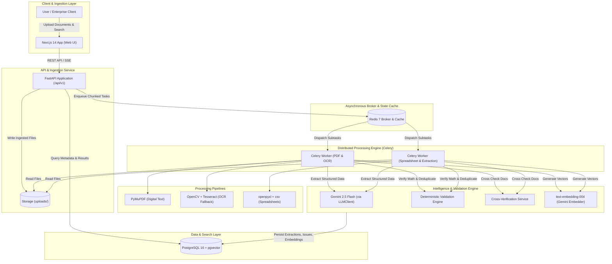
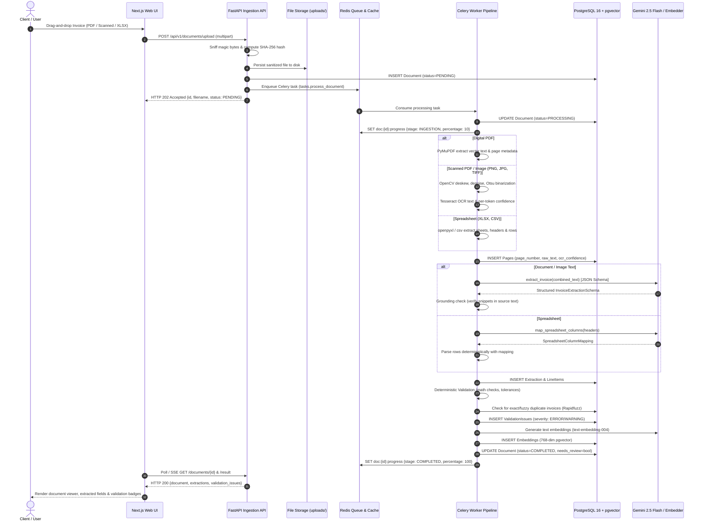
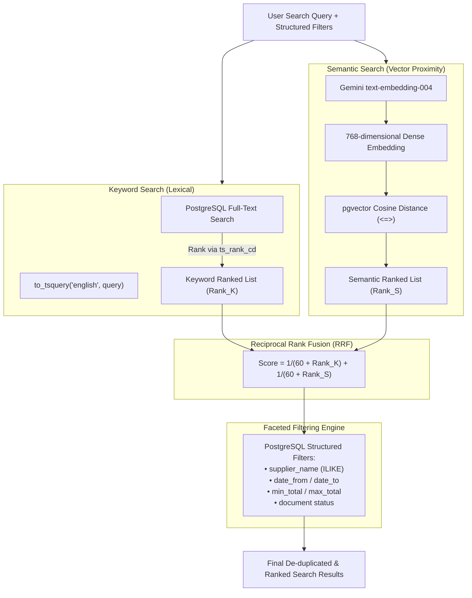
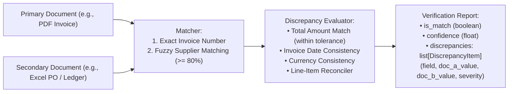

# System Architecture: AI Document Intelligence

## Overview

The AI Document Intelligence System is an enterprise-grade document extraction, financial validation, and semantic search platform designed as a decoupled, microservices-ready monorepo comprising:
- **FastAPI Backend (`/backend`)**: High-throughput asynchronous REST API providing file ingestion, document query, result retrieval, manual correction, and search.
- **PostgreSQL 16 + pgvector**: Unified relational metadata store, full-text inverted index (`tsvector`), and high-dimensional vector embeddings for semantic search.
- **Redis 7**: Distributed task queue broker and in-memory cache for ingestion state and live progress counters.
- **Celery Distributed Workers**: Asynchronous, parallel background workers responsible for PDF chunking, OpenCV image preprocessing, Tesseract OCR fallback, spreadsheet parsing, LLM structured extraction, and deterministic validation.
- **Next.js Web Frontend (`/frontend`)**: Modern React interface providing multi-file drag-and-drop ingestion, live page-level progress monitoring, side-by-side inspection with original document rendering, inline validation alerts, editable fields, and hybrid search.

---

## 1. High-Level Architecture Topology

---

## 2. Ingestion & Extraction Pipeline Sequence Diagram

---

## 3. Hybrid Search Architecture (Reciprocal Rank Fusion)

The hybrid retrieval engine combines exact keyword matching with deep semantic vector proximity to guarantee both keyword precision and semantic recall:

### Mathematical Formulation
The score for document $d$ across retrieval channels is computed as:
$$RRF(d) = \sum_{m \in \{K, S\}} \frac{1}{k + \text{rank}_m(d)}$$
where $k = 60$ is the standard smoothing constant dampening the outlier impact of individual high ranks.

---

## 4. Cross-Verification Reconciliation Flow

---

## 5. Architectural Components Breakdown

### 5.1 Storage & Magic-Byte Sniffing
Every uploaded document is inspected via `python-magic` (`libmagic`) inspecting binary signatures. Untrusted client MIME headers and file extensions are completely ignored. Supported formats:
- **PDF**: `%PDF-` magic header.
- **TIFF**: `II*\x00` (little-endian) or `MM\x00*` (big-endian).
- **PNG**: `\x89PNG\r\n\x1a\n`.
- **JPEG**: `\xff\xd8\xff`.
- **XLSX / XLS**: OpenXML ZIP container verified via `openpyxl`.
- **CSV**: Sniffed via Python standard library `csv.Sniffer`.

### 5.2 Deterministic Validation Engine
Validation is strictly deterministic Python code:
- **Missing Required Fields**: Flags `MISSING_INVOICE_NUMBER`, `MISSING_INVOICE_DATE`, `MISSING_SUPPLIER_NAME`, `MISSING_TOTAL`.
- **Arithmetic Consistency**:
  - Checks if `subtotal + tax == total` within configurable tolerance (default: $0.01).
  - Checks if $\sum \text{line\_totals} == \text{subtotal}$.
  - Checks line items: $\text{quantity} \times \text{unit\_price} == \text{line\_total}$.
- **Duplicate Detection**: Exact matching on `(invoice_number, supplier_name)` and fuzzy supplier name matching using Rapidfuzz (`token_sort_ratio >= 80`).
- **Currency Consistency**: Flags line item currencies that conflict with header currency.
- **Human Review Flagging**: Any validation error or extraction confidence $< 0.80$ flags `needs_review = true`.

### 5.3 Scalability Architecture (1,000-Page Documents)
To process massive multi-page documents (e.g., 1,000-page accounting packages) without memory exhaustion or worker timeouts:
1. **Streaming Ingestion**: Uploads stream chunked byte streams directly into shared NVMe/S3 storage.
2. **PyMuPDF Lightweight Chunking**: PyMuPDF opens PDFs in streaming read-only mode without loading all raster buffers into memory.
3. **Celery Canvas Chunking**: Pages are divided into chunks of 10-20 pages and distributed across independent Celery worker processes via Celery `group` / `chord` primitives.
4. **Redis Atomic Accumulators**: Redis atomic hashes track per-page completion percentages (`pages_done / pages_total`).
5. **Database Bulk Insertion**: Page text and embeddings are persisted using SQLAlchemy `bulk_save_objects` to avoid single-row roundtrip overhead.
