# Database Schema Design: AI Document Intelligence

## Overview

The database leverages PostgreSQL 16 with the `pgvector` extension. It stores relational document metadata, page-level OCR and extracted text, structured extraction outputs (with JSONB raw LLM payloads), detailed line items, deterministic validation issues, audit history of user corrections, processing stage timings, and high-dimensional vector embeddings.

## Entity-Relationship Diagram (ERD)

```mermaid
erDiagram
    documents ||--o{ pages : "contains"
    documents ||--o{ extractions : "has"
    documents ||--o{ validation_issues : "records"
    documents ||--o{ corrections : "audits"
    documents ||--o{ processing_events : "tracks"
    documents ||--o{ embeddings : "indexes"
    extractions ||--o{ line_items : "contains"

    documents {
        uuid id PK "Primary Key"
        varchar filename "Original filename"
        varchar file_type "Normalized format (pdf, tiff, xlsx, etc.)"
        varchar mime_type "Detected MIME type from magic bytes"
        bigint file_size "Size in bytes"
        varchar file_hash "SHA-256 hash for deduplication"
        varchar storage_path "Relative path in uploads storage"
        varchar status "PENDING, PROCESSING, COMPLETED, FAILED"
        int page_count "Total detected pages"
        boolean needs_review "True if validation issues or low confidence"
        timestamptz created_at "Creation timestamp"
        timestamptz updated_at "Update timestamp"
    }

    pages {
        uuid id PK "Primary Key"
        uuid document_id FK "References documents(id)"
        int page_number "Page index starting at 1"
        text raw_text "Extracted raw page text"
        varchar extraction_method "digital_pdf, tesseract_ocr, excel_sheet"
        float ocr_confidence "Average confidence score (0.0 - 1.0)"
        int char_count "Total character count"
        timestamptz created_at "Timestamp"
    }

    extractions {
        uuid id PK "Primary Key"
        uuid document_id FK "References documents(id)"
        varchar invoice_number "Extracted invoice identifier"
        date invoice_date "Extracted invoice date in ISO 8601"
        varchar supplier_name "Supplier / Vendor name"
        varchar customer_name "Customer / Buyer name"
        numeric subtotal "Subtotal before tax"
        numeric tax "Tax amount"
        numeric total "Grand total amount"
        varchar currency "ISO 4217 currency code (e.g. USD, EUR)"
        float overall_confidence "Aggregate extraction confidence"
        jsonb raw_llm_payload "Full raw structured JSON from LLM"
        varchar model_name "LLM model utilized"
        varchar prompt_version "Prompt template version"
        timestamptz created_at "Timestamp"
    }

    line_items {
        uuid id PK "Primary Key"
        uuid extraction_id FK "References extractions(id)"
        text description "Item description"
        numeric quantity "Item quantity"
        numeric unit_price "Price per unit"
        numeric line_total "Line item total amount"
        float confidence "Field extraction confidence"
        timestamptz created_at "Timestamp"
    }

    validation_issues {
        uuid id PK "Primary Key"
        uuid document_id FK "References documents(id)"
        varchar code "Error code (e.g., MATH_MISMATCH, MISSING_FIELD)"
        varchar severity "ERROR, WARNING, INFO"
        varchar field "Affected field (or 'general')"
        text message "Human-readable explanation"
        jsonb details "Contextual numbers, calculated vs expected"
        timestamptz created_at "Timestamp"
    }

    corrections {
        uuid id PK "Primary Key"
        uuid document_id FK "References documents(id)"
        varchar field_name "Modified field name"
        text old_value "Original extracted value"
        text new_value "Corrected value entered by human reviewer"
        text reason "Correction explanation or rationale"
        varchar updated_by "Reviewer ID / identifier"
        timestamptz created_at "Timestamp"
    }

    processing_events {
        uuid id PK "Primary Key"
        uuid document_id FK "References documents(id)"
        varchar stage "INGESTION, OCR, EXTRACTION, VALIDATION, VECTORIZE"
        varchar status "STARTED, SUCCESS, FAILED"
        float duration_ms "Execution time in milliseconds"
        text error_message "Error description if failed"
        timestamptz created_at "Timestamp"
    }

    embeddings {
        uuid id PK "Primary Key"
        uuid document_id FK "References documents(id)"
        uuid page_id FK "Optional page reference"
        text chunk_text "Chunk text used for embedding"
        vector embedding "Vector embedding"
        timestamptz created_at "Timestamp"
    }
```

## Indexes
- `documents`: B-Tree index on `file_hash`, B-Tree index on `status`, B-Tree on `needs_review`.
- `extractions`: B-Tree on `(supplier_name, invoice_number)`, B-Tree on `invoice_date`.
- `pages`: Full-text search GIN index on `to_tsvector('english', raw_text)`.
- `embeddings`: HNSW or IVFFlat index on `embedding vector_cosine_ops`.
